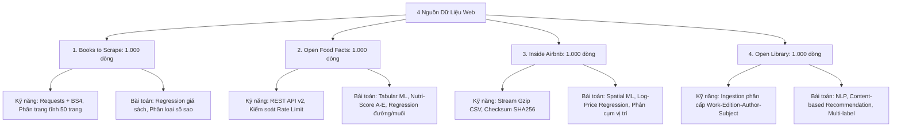

# BÁO CÁO TỔNG KẾT: XÂY DỰNG HỆ THỐNG THU THẬP DỮ LIỆU WEB CHO MACHINE LEARNING (DS102)

**Môn học**: DS102 – Học máy thống kê  
**Đơn vị**: Khoa Khoa học Dữ liệu – Trường ĐH Công nghệ Thông tin (UIT - VNU-HCM)  
**Tác giả**: DS102 Research & Practical Team  

---

## 1. Đặt Vấn Đề & Mục Tiêu

Trong quy trình phát triển mô hình Machine Learning thực tế, chất lượng và phương thức thu thập dữ liệu (Data Collection & Pipeline Ingestion) đóng vai trò quyết định đến hiệu quả của mô hình. 

Thực hành thu thập dữ liệu web thường gặp các thách thức:
1. **Lạm dụng Browser Automation (Playwright/Selenium)** khi trang web hoàn toàn có thể bóc tách bằng HTTP request tĩnh, dẫn đến tiêu tốn tài nguyên và dễ lỗi ngẫu nhiên.
2. **Dữ liệu thiếu đa dạng thuộc tính**: Chỉ thu thập các biến thô (ví dụ: chỉ có tên và giá), không đủ biến số học (continuous), biến thứ bậc (ordinal), biến phân loại (categorical) và văn bản (text).
3. **Rò rỉ nhãn (Target Leakage)**: Đưa các biến trực tiếp cấu thành nhãn mục tiêu vào đặc trưng huấn luyện.

Dự án này triển khai tuần tự **4 bộ dữ liệu web chất lượng cao**, mỗi bộ đại diện cho một nhóm bài toán Machine Learning cốt lõi.

---

## 2. Tổng Quan 4 Nguồn Dữ Liệu & Bài Toán Machine Learning

### So Sánh Kỹ Thuật

| Tiêu chí | 1. Books to Scrape | 2. Open Food Facts | 3. Inside Airbnb | 4. Open Library |
| :--- | :--- | :--- | :--- | :--- |
| **Giao thức** | HTTP GET (HTML) | REST API v2 (JSON) | Direct Gzip Download (CSV.GZ) | REST API (JSON Docs) |
| **Kỹ thuật trích xuất** | BeautifulSoup4 (DOM traversal) | Ingestion lọc theo 10 danh mục | Pandas Stream / Chunk filtering | Phân cấp thực thể (Relational) |
| **Khối lượng chuẩn** | 1.000 bản ghi (50 trang) | 1.000 bản ghi | 1.000 bản ghi | 1.000 bản ghi |
| **Độ phức tạp tiền xử lý** | Thấp (Regex giá, map rating) | Trung bình (Xử lý missing, loại outlier vô lý) | Trung bình (Làm sạch tiền tệ, parse amenities JSON) | Trung bình (Tách bảng quan hệ author, subject) |
| **Định dạng xuất** | CSV, JSON, SQLite | CSV, SQLite, JSONL | CSV, SQLite, Checksum metadata | CSV chính, CSV quan hệ, SQLite |

---

## 3. Kiến Trúc Pipeline & Thiết Kế Module

Hệ thống được tổ chức theo kiến trúc chuẩn sản xuất (Production-ready Pipeline):
* `src/collectors/`: Đảm nhiệm việc tải dữ liệu từ internet, quản lý rate limit, retry và lưu trữ dữ liệu thô (`data/raw/`).
* `src/cleaning/`: Kiểm tra schema, chuẩn hóa kiểu dữ liệu, xử lý missing value theo nguyên tắc **giữ nguyên NaN, không biến mất thông tin thành 0**, khử trùng lặp và lưu trữ vào `data/processed/` dưới dạng CSV và cơ sở dữ liệu SQLite.
* `src/features/`: Kỹ thuật tạo đặc trưng (Feature Engineering) phục vụ huấn luyện mô hình.
* `run_pipeline.py`: Bộ điều khiển trung tâm cho phép chạy tuần tự hoặc chọn lọc từng nguồn dữ liệu.

---

## 4. Nguyên Tắc Phòng Chống Target Leakage

Trong quá trình xây dựng bài toán Machine Learning cho 4 bộ dữ liệu trên, các nguyên tắc sau được áp dụng triệt để:

1. **Với Open Food Facts (Dự đoán Nutri-Score A–E)**:
   - Điểm Nutri-Score nguyên bản được tính từ hàm lượng đường, chất béo bão hòa, muối và năng lượng.
   - Khi huấn luyện mô hình phân loại tổng thể hoặc phân loại nhóm sản phẩm, không đưa các nhãn trung gian hoặc điểm số Nutri-Score nội bộ vào feature set.
2. **Với Inside Airbnb (Dự đoán Giá thuê `log_price`)**:
   - Chỉ sử dụng các đặc trưng vốn có của bất động sản trước khi khách thuê (loại phòng, số phòng ngủ, vị trí địa lý, tiện nghi ban đầu).
   - Không đưa `review_scores_rating`, `number_of_reviews_ltm` vào dự đoán giá niêm yết ban đầu, vì các biến này phản ánh kết quả sau quá trình vận hành kinh doanh.
3. **Với Open Library (Dự đoán Thập niên xuất bản `publish_decade`)**:
   - Loại bỏ hoàn toàn `first_publish_year`, `publish_year_min`, `publish_year_max` khỏi vector đặc trưng huấn luyện.

---

## 5. Kết Luận & Hướng Phát Triển

Hệ thống đã chuẩn hóa toàn bộ luồng thu thập dữ liệu cho môn học DS102. Sinh viên và nhóm nghiên cứu có thể:
1. Chạy `python run_pipeline.py --source all` để tự động hóa toàn bộ quy trình từ tải thô đến chuẩn hóa bảng và tạo database SQLite.
2. Sử dụng các file database `*.db` và CSV sạch tại `data/processed/` cho các bài tập thực hành tiếp theo: Hồi quy tuyến tính (Linear/Ridge/Lasso), Cây quyết định (Random Forest/XGBoost), Phân cụm (K-Means/DBSCAN), và Xử lý ngôn ngữ tự nhiên (TF-IDF/Word2Vec).
